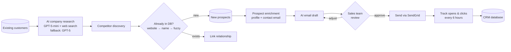

# AI-Powered B2B Sales Pipeline & Database Migration

**n8n · PostgreSQL · OpenAI · SendGrid**

> 🔒 This project is under NDA. Client name, people, data, and internal identifiers are left out. The description below is generalized.

| | |
|---|---|
| **Client** | European B2B company |
| **My role** | Lead n8n automation engineer: design, build, migration, documentation |
| **Team** | Client-side business analyst + in-house database developer |
| **Engagement** | Long-term contract, 2026 — ongoing |

---

## The problem

The sales team did prospect research by hand. For each company they had to find out what it does, who its competitors are, and who to contact, then write a personal email. This was slow, inconsistent, and impossible to scale.

**Goal:** turn a raw list of companies into researched prospects and personalized, human-approved outreach emails, with every step tracked in one database.

## The result

| | |
|---|---|
| 🌙 **Every night, unattended** | 75 companies researched, up to 250 personalized emails prepared |
| 📈 **Per month** | ~2,250 companies researched, up to ~7,500 emails ready for review |
| 🔍 **Data points per company** | 10+ (activity, values, challenges, revenue, headcount, industry code, news, social links, competitors) |
| 🔁 **Engagement sync** | Opens and clicks flow back to the CRM every 6 hours |
| 🛡️ **Duplicate protection** | 3 steps for every new company: website → exact name → fuzzy match |
| ✅ **Database migration** | 100% of workflows moved to a new schema with zero downtime |

**Business impact:** the sales team now *reviews and approves* emails instead of researching and writing them from scratch. Automatic competitor discovery keeps growing the prospect database without duplicates.

---

## How it works

About 10 connected n8n workflows run every night and pass data to each other through PostgreSQL.



### 1. Customer intelligence & competitor discovery
Each night, existing customers are researched with an LLM using web search. If the smaller model fails, a stronger model takes over. The result is a structured company profile. The AI also finds competitors, which become new prospects after a 3-step duplicate check.

### 2. Prospect enrichment
New prospects get the same AI profile plus contact-email discovery and validation. Every AI response is validated as structured JSON before anything is saved.

### 3. AI email drafts with human approval
Personalized outreach emails are generated in the prospect's local language, using the company profile and recent news as context. Each draft goes through a clear lifecycle: **draft → approved → sent**. The sales team can adjust or regenerate any draft before approving it.

### 4. Sending & engagement tracking
Approved drafts are converted to email-safe HTML with a branded footer and sent via SendGrid. A scheduled workflow syncs opens and clicks back to the CRM. Unsubscribe handling is built in (GDPR-aware).

### 5. Regional enrichment
Postal codes are mapped to regions using reference tables built from public data. Companies are enriched with a fast database lookup instead of a web call for every record.

### 6. Logging
Every AI step logs its status, errors, and run time. Nightly runs are easy to audit, and failures are easy to trace.

---

## Phase 2: zero-downtime database migration

The client's developer designed a new unified database schema. I migrated all production workflows to it.

- **Blue-green deployment:** old and new workflows ran side by side until the new ones were proven stable, then switched over cleanly.
- **Live database as the source of truth:** I checked every step against the real tables, not just design documents, and caught schema mismatches before they reached production.
- **Simpler architecture:** I merged a separate workflow into the main one when its old data structure no longer existed, and documented the decision for the client.

---

## Challenges I solved

**The AI listed a company as its own competitor.**
Sometimes the model returned the analyzed company under a different legal name. I fixed it on two levels: rules in the prompt, and a database guard so bad output can never break the data.

```sql
-- Illustrative pattern (names changed): save a link only if it's valid and new
INSERT INTO links (source_id, target_id)
SELECT :source, :target
WHERE :source <> :target
ON CONFLICT DO NOTHING;
```

**False matches on empty values.**
Companies without a website were matched to unrelated records that also had no website. I fixed it by normalizing values, so only real, non-empty URLs are compared.

**n8n platform limits.**
Nested batch loops were silently dropping items, so I moved that logic into a sub-workflow. I also worked around expression-engine quirks with regex and JSONB data types.

---

## Skills shown

n8n · Workflow Automation · AI Agents & LLM Integration · OpenAI API · Prompt Engineering · PostgreSQL · Database Migration · Data Enrichment · CRM Automation · Email Automation · SendGrid API · REST APIs & Webhooks · Lead Generation · Technical Documentation

---

[← Back to portfolio](../../README.md)
